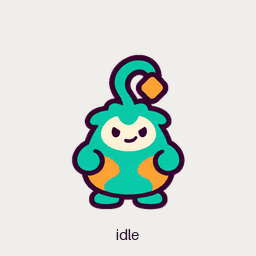

# GPTomek

A pocket-sized teal token gremlin with a tangerine antenna. An original companion for ChatGPT and Codex.

## Install

Copy the [pet manifest](pet/pet.json) and [spritesheet](pet/spritesheet.webp) into a folder named `gptomek` in your desktop app's pets directory. The default is `~/.codex/pets/` on macOS and Linux and `%USERPROFILE%\.codex\pets\` on Windows. If `CODEX_HOME` is set, use its `pets/` directory.

Open **Settings → Pets**, refresh the list and select **GPTomek**.

## Animations

The transparent, lossless WebP uses the v2 atlas layout. It contains 57 frames across nine states and [16 clockwise look directions](gallery/look.gif) in an 8×11 grid of 192×208 px cells.
