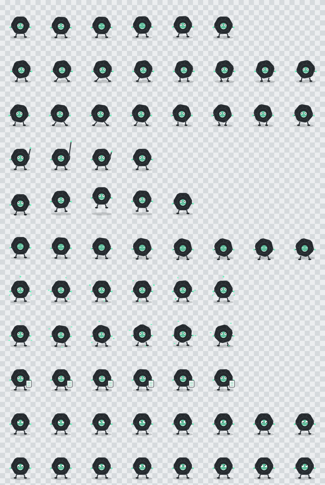

# Loopling 🌀

[](https://www.python.org/) [](https://developers.google.com/speed/webp)

Original animated ChatGPT/Codex desktop pet. Unofficial fan artwork, not an OpenAI logo or endorsement.



## Install

```powershell
# Windows
.\scripts\install.ps1
```

```sh
# macOS / Linux
./scripts/install.sh
```

Or copy `pet/pet.json` and `pet/spritesheet.webp` to `$CODEX_HOME/pets/loopling/` (default `~/.codex/pets/loopling/`). Restart ChatGPT, refresh **Settings → Pets**, select Loopling.

## Maintained sources

| Path | Purpose |
| --- | --- |
| `pet/` | Installable runtime manifest and sprite atlas |
| `tools/generate.py` | Deterministic procedural artwork generator |
| `gallery/` | Contact sheet, nine state GIF previews and `validation.json` |
| `scripts/` | Platform installers |

```sh
python -m pip install -r requirements.txt
python tools/generate.py
```

**Pet v2:** transparent lossless WebP `1536×2288`, 8×11 cells `192×208`; 57 standard frames plus 16 gaze directions, `spriteVersionNumber: 2`. States include idle, walk, wave, jump, fail, waiting, working, review and directional gaze. Regenerate from the maintained generator, not manual edits to the derived spritesheet. [MIT license](LICENSE).
