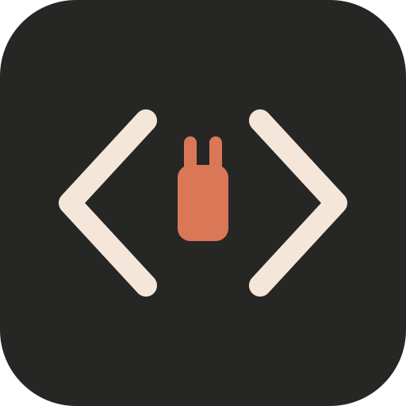

# Claudin



Live official docs for Claude Code, claude.ai/Cowork, the Claude API, MCP, the Agent Client Protocol, OpenAI/Codex and xAI/Grok — looked up, not remembered. Plus builder skills for plugins, MCP servers and skills. Replaces Anthropic's `plugin-dev` and `mcp-server-dev` and the MCP `mcp-apps` plugin (their pins had gone stale: hook list, manifest fields, ext-apps 1.x, pre-2026 spec).

## Just want answers

Install it and ask: "how do Claude Code hooks block a tool call?", "does Cowork run plugin agents?", "what changed in the MCP 2026-07-28 spec?". `docs-lookup` picks the right server, reads the full page and answers with the link. The builder skills use the same connector-first route (these seven, plus GitHub, Google Developer, Microsoft Learn, Cloudflare or Context7 when connected), falling back to WebFetch only when no connector covers the site or it fails.

| Docs MCP (public, authless) | Covers |
|---|---|
| `claude-code-docs` — `https://code.claude.com/docs/mcp` | Claude Code: CLI, settings, hooks, subagents, skills, plugins, LSP, Agent SDK |
| `claude-ai-docs` — `https://claude.com/docs/mcp` | claude.ai/Cowork features, plugins & skills, surface support matrix, connectors, directory review |
| `claude-platform-docs` — `https://platform.claude.com/docs/mcp` | Claude API, SDK reference, Managed Agents, models |
| `mcp-docs` — `https://modelcontextprotocol.io/mcp` | MCP spec revisions, SDKs, extensions (Apps, Skills), Inspector |
| `acp-docs` — `https://agentclientprotocol.com/mcp` | Agent Client Protocol (editor ↔ coding agent): spec v1/v2, libraries, registry, RFDs |
| `openai-docs` — `https://developers.openai.com/mcp` | OpenAI API, Codex/ChatGPT plugins, Agent Plugins manifest, Apps SDK |
| `xai-docs` — `https://docs.x.ai/api/mcp` | Grok Build (plugins, skills, hooks, MCP, CLI) and the xAI API |

`openai-docs` uses the same official endpoint as OpenAI Dev Kit. Verify connection reuse or registered App bindings in the target host.

## Building something

| Skill | What it does |
|---|---|
| `plugin-dev` | Surface matrix (chat/Cowork/Code/Codex/Grok Build), portable layout, gotchas, Claude Code component shapes, Claude→OpenAI conversion, other hosts (Grok Build, Copilot CLI, Antigravity, Gemini CLI, M365 Cowork) |
| `mcp-dev` | Deployment choice, tool design + directory rules, OpenAPI wrapping, OAuth (CIMD/DCR), MCP Apps (standard vs `window.openai`), Skills over MCP, MCPB, submission; `scripts/mcp_probe.py` probes any remote server (both spec eras) and lints annotations |
| `skill-creator-v2` | Skill lifecycle hub: need-a-skill check, index reconcile, create/edit, evals + viewer + benchmark, description optimization (`claude -p`, Claude Code), OpenAI `agents/openai.yaml`, claude.ai compat audit, `quick_validate` / `package_skill`. Moved here from standalone (uninstall that copy) |

## Surfaces

- **claude.ai chat / Cowork:** skills + the seven remote MCPs. The sandbox runs `mcp_probe.py` against public URLs.
- **Claude Code:** same, plus `claude plugin validate`, Inspector, local servers, MCPB packing.
- **Codex / ChatGPT:** `.codex-plugin/plugin.json` overlay; skills are provider-neutral where it matters.
- **Antigravity:** `agy plugin import claude`, or the `.antigravity-plugin/` + `mcp_config.json` overlay from the account build. **Gemini CLI:** needs a `gemini-extension.json`. Neither overlay is kept in this repo: both would duplicate the `mcp.json` URL list.
- **Grok Build, Copilot CLI:** load this plugin as a Claude Code plugin, no extra files.

Docs for hosts without a bundled MCP (GitHub Copilot, Antigravity, Gemini CLI, M365) are fetched from their official sites; the GitHub, Google Developer Knowledge and Microsoft Learn connectors are used only if the session already has them.

Related, not duplicated: `skill-creator-v2` (SKILL.md authoring, packaging, claude.ai compat), built-in `plugin-authoring` (mods), `product-self-knowledge` (plans, pricing), `cloudflare` (Worker hosting).

Sources and licenses: each skill's `NOTICE.md` / `LICENSE.txt`.

OpenAI Dev Kit consolidation (Nov 2026): focused API/Codex workflows in `docs-lookup/references/`; OpenAI scaffolds and validator in `plugin-dev/scripts/`; build and MCP Apps reference notes in `plugin-dev/references/openai-kit/`. Existing four skill IDs and seven endpoints stay unchanged. The standalone OpenAI Dev Kit remains temporarily available for installed clients; further integration changes belong here.

## twojstar package

Canonical source here is the portable `plugin.json` + `mcp.json` + `skills/`; the Claude Code marketplace entry and the Codex overlay are generated (`plugins/_shared/`).

```sh
python -m pip install -r plugins/_shared/requirements.txt
python plugins/_shared/package_plugin.py plugins/claudin /tmp/claudin.zip
```

Claude Code: `/plugin install claudin@twojstar` (after `/plugin marketplace add travnie/twojstar`).


## Links

https://claude.com/docs
https://code.claude.com/docs
https://learn.chatgpt.com
https://developers.openai.com
https://help.openai.com

