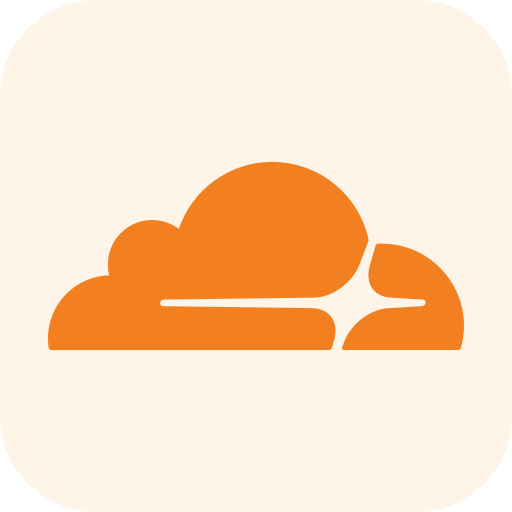

# Cloudflare



Cloudflare developer platform for Claude and ChatGPT/Codex: hosted MCP server + routing skill. Portable Agent Plugins 1.0 source; the packager emits Claude and Codex layouts.

## Components

| Component | What it does |
|-----------|--------------|
| MCP server (`mcp.json`) | `https://mcp.cloudflare.com/mcp` — Code Mode: `search`/`docs` over current Cloudflare docs, `execute` for authenticated REST API calls (OAuth on first use) |
| Skill `cloudflare` | Picks product and CLI, then routes into references: Workers, Static Assets, Pages, Cron, bindings, KV, D1, R2, Durable Objects, Workers AI, AI Gateway, Agents SDK, frameworks (Next.js/vinext, Astro, React Router…), app bootstrap, local dev, `cf` CLI, Wrangler, Workers profiling, HTTP error triage |
| `agents/openai.yaml` | Codex interface, product policy `[CHAT, CODEX]` |
| `mcp-auth.json`, [`AUTHENTICATION.md`](AUTHENTICATION.md) | Public auth policy and onboarding |

## Setup

Sign in to Cloudflare when the connector asks (OAuth). No tokens, cookies or app IDs in this package.

## Usage

`/cloudflare` or any Cloudflare / Worker / binding task. Reads are free-form; deploys, writes, secrets and deletes only on explicit request.

## Package

From the repository root:

```sh
python -m pip install -r plugins/_shared/requirements.txt
python plugins/_shared/plugin_ci.py build cloudflare /tmp/cloudflare
```

## Upstream sync

Synced with `github.com/cloudflare/skills` at `cbf893b` (2026-11-10). The upstream `cloudflare-app-bootstrap`, `frameworks-on-cloudflare` and `workers-development` skills are folded in as references, plus the HTTP-error triage section. Local patches are listed in [`THIRD_PARTY_NOTICES.md`](THIRD_PARTY_NOTICES.md).

## Privacy

Cloudflare's privacy policy: https://www.cloudflare.com/privacypolicy/
